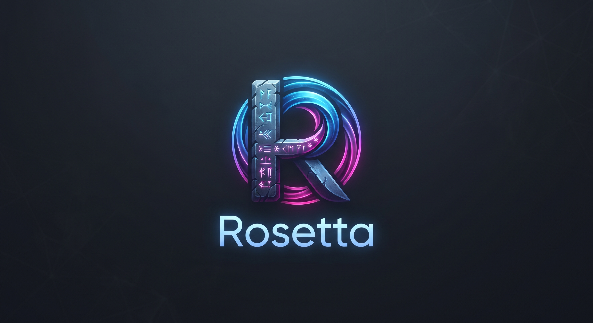

<div align="center">



# 🏛️ ROSETTA
### *The Universal Decryption & Localization Suite for Visual Novels & Narrative Games*

[](https://www.python.org/)
[](LICENSE)
[]()
[]()
[](https://github.com/adisc99)

**Rosetta** è la suite universale e specialistica per l'ispezione, decifrazione, traduzione neurale e localizzazione automatica di **Visual Novel e giochi a forte componente narrativa**.
</div>

---

## 🌟 Perché "Rosetta"?

Ispirato alla leggendaria *Stele di Rosetta*, il software funge da **chiave universale** per decodificare gli script di Visual Novel e giochi narrativi, abbattendo ogni barriera linguistica. 

Unisce in un unico **Master Hub Orchestrator (`rosetta.py`)** 4 potenti strumenti specialistici, preservando il codice sorgente, le formattazioni grafiche, i tag dei dialoghi e le personalità dei personaggi:

```
                                 🏛️ ROSETTA (Master CLI)
               ┌─────────────────────┬─────────────────────┬─────────────────────┐
               ▼                     ▼                     ▼                     ▼
        📜 Ren'Py (RITT)      ⚔️ RPG Maker (RPGMT)    🤖 Godot (GITT)       🎮 Unity (UITT)
        .rpa / .rpy / .rpyc   MV / MZ data/*.json   .pck / project.godot   *_Data / .assets
```

---

## 🎮 Matrice dei Motori Supportati

| Modulo | Motore di Gioco | Formati & Strutture Supportate | Caratteristiche Principali |
| :--- | :--- | :--- | :--- |
| **`rosetta renpy`** | **Ren'Py Engine** *(Visual Novels)* | `.rpa`, `.rpy`, `.rpyc`, `game/tl/` | Decrittazione RPA, de-compilazione bytecode, isolamento `characters.rpy`, mod patch F8, ZIP con backup. |
| **`rosetta rpgm`** | **RPG Maker MV / MZ** | `data/*.json`, `System.json`, `Map*.json`, `locales/` (DKTools), `img/pictures/` | Parsing dialoghi/eventi/database, supporto multilingua DKTools (`locales/` e `--source-lang`), OCR Vector Redraw per menu/UI (`rosetta rpgm images`), iniezione lingua `it` in `plugins.js` e `locale.rpgsave`. |
| **`rosetta godot`** | **Godot Engine 3 & 4** | `.pck`, `.tscn`, `.gd`, `project.binary` | Estrazione pacchetti PCK binari, generazione CSV di localizzazione e ricompilazione pacchetto. |
| **`rosetta unity`** | **Unity Engine** | `*_Data/`, `resources.assets`, `.unity3d` | Ispezione MonoBehaviour, TextAsset, dizionari di traduzione universali `translation.json`. |

---

## ✨ Caratteristiche Fondamentali

1. **Auto-Detection Intelligente**:
   Basta passare il percorso di una cartella di gioco o di un archivio: Rosetta rileva automaticamente il motore (*Ren'Py, RPG Maker, Godot o Unity*) e orchestra il modulo corretto.
2. **Motori AI di Ultima Generazione**:
   - **Google Gemini**: Supporto nativo per **`gemini-3.5-flash-lite`** (ultra-rapido, 15-20 frasi al secondo, consigliato e predefinito), `gemini-3.6-flash` e `gemini-3.1-pro`.
   - **DeepL API**: Traduzione professionale con controllo della formalità (*Tu / Lei*).
   - **OpenAI & Claude**: Pieno supporto per `gpt-4o-mini`, `gpt-4o`, `claude-3-5-sonnet`.
   - **Ollama (Locale)**: Modelli AI (Llama 3.1, Mistral, Qwen) in esecuzione 100% offline sul proprio PC.
   - **Google Translate**: Diretto, gratuito e senza configurazione.
3. **Preservazione Rigorosa di Tag & Variabili**:
   Protegge tag grafici (`{b}`, `{i}`, `{color=...}`, `\n`, `\C[2]`, `\N[1]`) e placeholder di codice (`[player_name]`, `%(var)s`) impedendo qualsiasi corruzione o crash in-game.
4. **Estrazione Nomi Personaggi per Post-Produzione (`characters.rpy`)**:
   Isola automaticamente tutti i nomi dichiarati in `Character()` in un file dedicato per consentire una rapida revisione manuale.
5. **Installazione Patch con Backup di Sicurezza Automatico**:
   Verifica preventiva dello stato della patch: se i file sono già identici e aggiornati evita scritture inutili; in caso di aggiornamenti crea un backup preventivo ripristinabile con un solo comando.
6. **Esperienza Multi-Interfaccia**:
   - **Master CLI (`rosetta`)**: Per automazioni rapide, script e server headless.
   - **Desktop GUI (Tkinter)**: Interfaccia visiva completa con statistiche in tempo reale ed editor dialoghi.
   - **Terminal TUI (Textual)**: Elegante interfaccia terminale stile retro con navigazione da tastiera.
   - **Web UI Studio (Flask)**: Dashboard web moderna accessibile da browser (porta 5000).

---

## 📦 Installazione

### 1. Clonazione del Repository
```bash
git clone https://github.com/adisc99/RITT.git rosetta
cd rosetta
```

### 2. Installazione Dipendenze
```bash
pip install -r requirements.txt
```

*(Opzionale)* Per abilitare il comando globale `rosetta` nel terminale di sistema:
```bash
pip install -e .
```

---

## ⚙️ Configurazione Chiavi API (`.env`)

Crea o modifica il file `.env` nella directory principale (il file è già escluso da Git per la tua sicurezza):

```env
# Google Gemini API (Consigliato, Ultra-Veloce su Google AI Studio)
GEMINI_API_KEY="AIzaSy..."
GEMINI_MODEL="gemini-3.5-flash-lite"
LLM_PROVIDER="gemini"
LLM_MODEL="gemini-3.5-flash-lite"

# DeepL API Key (Opzionale)
DEEPL_API_KEY=""

# OpenAI / Anthropic Claude / Groq (Opzionali)
OPENAI_API_KEY=""
ANTHROPIC_API_KEY=""
GROQ_API_KEY=""

# F95Zone Tracker Credentials (Opzionali)
user="tua_email@example.com"
password="tua_password"
```

---

## 🚀 Utilizzo da Riga di Comando (CLI)

> 📖 **Nota**: Per la guida dettagliata con la spiegazione di tutti i singoli flag, opzioni avanzate ed esempi completi per ogni motore, consulta il manuale dedicato: **[`ROSETTA_COMMANDS.md`](ROSETTA_COMMANDS.md)**.

### 🩺 1. Verifica Salute di Sistema (`doctor`)
Controlla la configurazione dell'ambiente, le API Key caricate e la latenza del modello AI predefinito:
```bash
python3 rosetta.py doctor
```

### 🎮 2. Visualizza la Matrice dei Motori (`engines`)
```bash
python3 rosetta.py engines
```

---

### 🔍 3. Scansione Statistica del Gioco (`scan`)
Analizza archivi, script e calcola il numero di dialoghi, parole e personaggi salvando automaticamente il manifest locale `.rosetta_scan.json` per velocizzare a <10ms le traduzioni successive:

```bash
# Auto-detection intelligente del motore (genera o riutilizza il manifest locale):
python3 rosetta.py scan /percorso/del/gioco

# Forza la riscansione ignorando il manifest locale:
python3 rosetta.py scan /percorso/del/gioco --force-scan

# Oppure comando esplicito per motore:
python3 rosetta.py renpy scan /percorso/gioco_renpy
python3 rosetta.py rpgm scan /percorso/gioco_rpgm
python3 rosetta.py godot scan /percorso/gioco_godot
python3 rosetta.py unity scan /percorso/gioco_unity
```

---

### 🌐 4. Traduzione con AI Neurale (`translate`)

#### Esempi con Google Gemini (Predefinito: `gemini-3.5-flash-lite` ~15-20 frasi/s):
```bash
# Traduzione automatica con auto-detection dell'engine:
python3 rosetta.py translate /percorso/del/gioco

# Specificando il motore esplicito e opzioni avanzate:
python3 rosetta.py renpy translate /percorso/del/gioco --engine llm --provider gemini --model gemini-3.5-flash-lite

# Con iniezione diretta nel gioco e backup preventivo:
python3 rosetta.py translate /percorso/del/gioco --auto-inject

# Con motore gratuito Google Translate:
python3 rosetta.py translate /percorso/del/gioco --engine google
```

---

### 🗜️ 5. Ottimizzazione & Compressione del Gioco (`compress`)
Riduce il peso del gioco del **60% - 80%** (es. da 8 GB a ~2 GB), convertendo immagini e asset in formato WebP ad alta efficienza e creando automaticamente un archivio ZIP distribuibile pronto per essere condiviso:

```bash
# Compressione in una nuova cartella pulita (lasciando l'originale intatto):
python3 rosetta.py compress /percorso/del/gioco

# Compressione + creazione automatica del file ZIP distribuibile pronto per il download:
python3 rosetta.py compress /percorso/del/gioco --pack-zip

# Simulazione preventiva dello spazio risparmiato (senza modificare file su disco):
python3 rosetta.py compress /percorso/del/gioco --dry-run
```

---

### 📦 6. Installazione Patch e Ripristino Backup (`apply` & `restore`)

```bash
# Applica una patch ZIP con controllo preventivo e backup:
python3 rosetta.py apply /percorso/del/gioco traduzione_italiana.zip

# Forza l'applicazione anche se i file sono già identici:
python3 rosetta.py apply /percorso/del/gioco traduzione_italiana.zip --force

# Ripristina istantaneamente il gioco allo stato originale prima della traduzione:
python3 rosetta.py restore /percorso/del/gioco
```

---

## 🖥️ Interfacce Utente (Studio, GUI, Web UI)

Puoi avviare qualsiasi interfaccia visiva direttamente tramite Rosetta o tramite gli script standalone:

### 1. Suite Moderna Unificata: Rosetta Studio (Consigliata)
Moderna suite grafica multipiattaforma (Flet/Flutter) con Universal Dropzone per tutti i motori (Ren'Py, RPG Maker, Godot, Unity), monitoraggio telemetrico in tempo reale e studio OCR:
```bash
python3 rosetta.py studio       # Avvia Rosetta Studio (oppure doppio clic su avvia_studio.bat)
```

### 2. Ren'Py Translation Studio Classic Desktop (GUI Tkinter)
```bash
python3 rosetta.py renpy gui    # Apre RITT.py (oppure doppio clic su avvia_renpy_gui.bat)
```

### 3. Web UI Universale (Browser)
```bash
python3 rosetta.py web          # Avvia il server locale su http://127.0.0.1:5000
```

> ℹ️ **Nota di Ottimizzazione Release**: Le interfacce da terminale Textual (TUI) e le interfacce legacy Tkinter per RPG Maker, Godot e Unity sono state dismesse e rimosse in favore della suite unificata **Rosetta Studio** e dei comandi CLI ad alte prestazioni.

---

## 📁 Struttura del Progetto

```
rosetta/
├── rosetta.py                      # 🏛️ Master Hub & CLI Universale (Auto-Detector)
├── rosetta-logo-toolkit.jpg        # 🎨 Logo ufficiale di Rosetta Suite
├── .env.example                    # ⚙️ Template configurazione variabili d'ambiente
├── renpytranslator/                # 📜 Modulo Ren'Py (Core, parser, patcher, webui)
│   ├── cli.py                      # CLI specialistica Ren'Py
│   ├── core/                       # RPA extractor, RPYC decompiler, TL generator
│   ├── translator/                 # Motori AI (Gemini, DeepL, OpenAI, Claude, Cache)
│   └── webui/                      # Server Flask e Web Dashboard
├── rpgmtranslator/                 # ⚔️ Modulo RPG Maker MV/MZ (Core, JSON parser)
│   └── cli.py                      # CLI specialistica RPG Maker
├── godottranslator/                # 🤖 Modulo Godot Engine (PCK builder, CSV parser)
│   └── cli.py                      # CLI specialistica Godot
├── unitytranslator/                # 🎮 Modulo Unity Engine (Asset extractor, parser)
│   └── cli.py                      # CLI specialistica Unity
├── rosetta_studio.py               # 🌟 Rosetta Studio (Moderna Suite Unificata Flet/Flutter)
├── RITT.py                         # 🖥️ Ren'Py Desktop GUI (RITT)
├── docs/                           # 📚 Guide complete per ciascun motore
└── tests/                          # 🧪 Suite di test unitari automatizzati
```

---

## 🧪 Esecuzione dei Test Automatizzati

Rosetta include una suite completa di oltre **80 test unitari** che coprono de-compilatori, parser di script, preservazione tag, estrazione archivi binari e gestione backup:

```bash
python3 -m unittest discover tests
```

---

## 📄 Licenza e Crediti

* **Autore / Ideatore**: `adisc`
* **Licenza**: MIT License
* **Repository Ufficiale**: [github.com/adisc99/RITT](https://github.com/adisc99/RITT)
